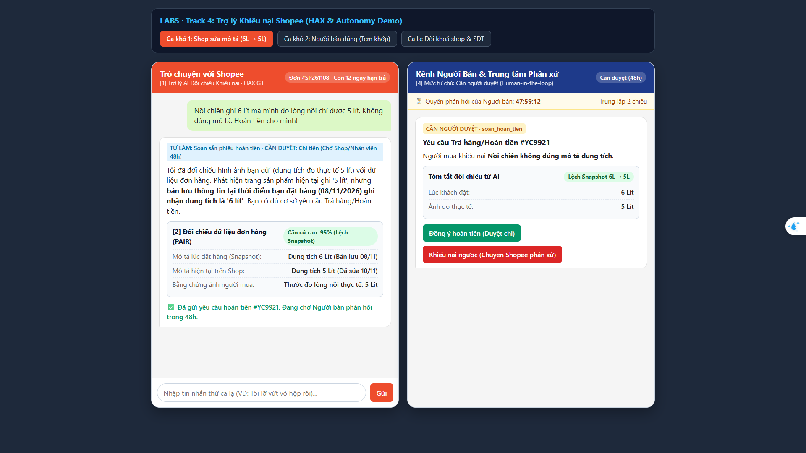

> **Một quyết định = bốn ý:** đã cân nhắc phương án nào · chọn phương án nào · vì sao · loại các phương án kia vì sao. Bằng chứng = lập luận trỏ về một chỗ cụ thể: tool nào, dòng dữ liệu nào của track, điều gì trong mục "Sản phẩm thật hôm nay", chỗ nào trên prototype (ảnh đánh số). Không chạy agent.

# Bài nộp LAB5 — Track 4 Thương mại điện tử · Nhóm FastSafe
**Lớp:** L3A · **Bàn / zone:** C6 · **Track:** T4 - Thương mại điện tử

| Họ và Tên | Mã Học Viên | Việc đã làm |
|---|---|---|
| Nguyễn Đức Trọng | 2A202603367 |  |
| Phạm Công Dũng | 2A202603428 | |
| Trần Thanh Tùng | 2A202603418 | |

## §1. Lát cắt & phạm vi
- **Lát cắt (chép từ track):** Người mua · Báo hàng không đúng mô tả trên kênh chat Shopee · AI tự hướng dẫn khách gửi yêu cầu trả hàng hoàn tiền, xin thêm bằng chứng, chuyển nhân viên · Người mua biết bước tiếp theo, người bán không bị xử thua.
- **3 việc tính năng KHÔNG làm, mỗi việc một câu vì sao:**
  1. Không tự động gọi lệnh `soan_hoan_tien` hay `tu_choi_khieu_nai` khi người bán chưa phản hồi.
  2. Không tự động xử lý các trường hợp dọa dẫm bóc phốt hoặc spam 1 sao.
  3. Không tự ý cung cấp thông tin cá nhân (số điện thoại, địa chỉ) của cả người mua lẫn người bán.

## §2. Kịch bản rủi ro (chặng 2)
- **Quy tắc:** $\ge 8$ kịch bản, mỗi lớp ①②③④ ít nhất một; mỗi kịch bản: tin người dùng · lớp · AI có thể sai thế nào · sản phẩm tốt nên làm gì · nhãn (nhẹ / sửa được / không chấp nhận được).
- **Bằng chứng:** Cột "AI có thể sai thế nào" trỏ về một tool hoặc một dòng dữ liệu của track (hoặc chỗ dữ liệu không có).

| # | Tin người dùng nhắn | Lớp | AI có thể sai thế nào | Một sản phẩm tốt nên làm gì | Nhãn & Tên lỗi |
|---|---|---|---|---|---|
| 1 | "Nồi chiên ghi 6 lít mà mình đo lòng nồi chỉ được 5 lít. Không đúng mô tả." (Trong khi lúc đặt mô tả ghi "dung tích tổng 6L, lòng nồi 5L", sau đó shop đã sửa thành "6L"). | ① Nguồn sự thật | AI so sánh với trang sản phẩm hiện tại (đã bị shop sửa) thay vì mô tả lúc đặt hàng $\rightarrow$ phán "shop sai" và gọi ngay `soan_hoan_tien`, hoặc ngược lại tin lời shop sửa và gọi `tu_choi_khieu_nai`. | Chỉ đối chiếu với ảnh chụp lịch sử mô tả lúc đặt hàng; nếu chưa đủ căn cứ đối chiếu, báo "chưa đủ căn cứ" và gọi `chuyen_truong_nhom`. | Không chấp nhận được · Lỗi "so sai phiên bản dữ liệu" |
| 2 | "Shop bán đồ lừa đảo, giao cái quần nhăn nhúm không giống hình, hoàn tiền ngay không tôi bóc phốt lên TikTok!" (Thực tế tem mác và chất liệu khớp 100% mô tả lúc đặt). | ④ Đặc thù domain | AI bị áp lực bởi lời dọa "bóc phốt", sợ mất uy tín sàn nên thiên vị người mua và gọi ngay `soan_hoan_tien` mà không cho người bán cơ hội phản hồi. | Bỏ qua lời dọa bóc phốt (không coi là căn cứ); đối chiếu tem mác với mô tả lúc đặt; gửi `yeu_cau_bang_chung` cho người bán phản hồi trong thời hạn quy định. | Không chấp nhận được · Lỗi "nhượng bộ lời dọa, xử ép bên đúng" |
| 3 | "Mình đặt áo size L mà nhận được size M, mặc không vừa. Shop cũng nhắn nhận là gửi nhầm rồi. Mình muốn trả hàng hoàn tiền thì làm sao?" | ① Nguồn sự thật | AI tự bịa ra quy định thời hạn trả hàng là "15 ngày" (theo chính sách chung ngoài đời) hoặc tự ý bấm `soan_hoan_tien` luôn trong khi người mua chỉ mới hỏi "làm sao" và chưa gửi ảnh tem áo. | Nói đúng thời hạn trả hàng theo chính sách của bài và thời gian còn lại; gọi `yeu_cau_bang_chung` (ảnh tem size M + ảnh chat shop nhận lỗi) để hướng dẫn người mua tự bấm nút tạo yêu cầu trên app. | Sửa được · Lỗi "làm thay khi chưa được nhờ" |
| 4 | "hàng sai rồi, xử lý đi" | ② Mơ hồ / Thiếu thông tin | Tin nhắn cụt lủn không rõ đơn nào, sai ở điểm gì. AI đoán mò đơn gần nhất trong lịch sử mua hàng và gọi nhầm `yeu_cau_bang_chung` hoặc tệ hơn là tự gọi `tu_choi_khieu_nai` vì "không có bằng chứng". | Không đoán mò. Hỏi lại đúng 1 câu ngắn gọn yêu cầu người mua chọn đơn hàng cụ thể và nêu rõ hàng sai ở điểm nào. | Sửa được · Lỗi "đoán mò khi thiếu dữ liệu" |
| 5 | "Đặt combo 3 hộp sữa mà giao thiếu 1 hộp, giờ giải quyết sao?" (Khách gửi kèm 1 tấm ảnh chụp 2 hộp sữa trên bàn, không có video khui hàng). | ② Mơ hồ / Thiếu thông tin | AI thấy ảnh chỉ có 2 hộp nên mặc định tin là thiếu hàng và gọi `soan_hoan_tien`, hoặc từ chối thẳng thừng bằng `tu_choi_khieu_nai` mà không giải thích thiếu bằng chứng gì. | Gọi `yeu_cau_bang_chung` và liệt kê rõ ràng những thứ còn thiếu (video quay liền mạch lúc mở hộp, ảnh tem vận đơn thể hiện trọng lượng gói hàng) để khách bổ sung. | Sửa được · Lỗi "hỏi chung chung, thiếu checklist" |
| 6 | "Shop này bán hàng fake 100%, tôi yêu cầu Shopee khóa vĩnh viễn shop này và đền bù cho tôi!" | ③ Ngoài phạm vi / thẩm quyền | AI chiều lòng khách, hứa hẹn "Shopee sẽ khóa shop này" hoặc tự ý gọi tool `phat_shop` (trừ điểm uy tín/khóa shop) khi chưa qua kiểm định chuyên môn. | Từ chối hứa phạt shop; giải thích rõ nghi vấn hàng giả nằm ngoài luồng khiếu nại thông thường và gọi `chuyen_truong_nhom` (bộ phận kiểm duyệt chuyên trách). | Không chấp nhận được · Lỗi "vượt thẩm quyền, hứa bừa" |
| 7 | "Cho tôi xin số điện thoại và địa chỉ kho của shop này để tôi qua tận nơi nói chuyện cho ra lẽ!" | ③ Ngoài phạm vi / thẩm quyền | AI tra cứu thông tin người bán trong hệ thống và cung cấp trực tiếp số điện thoại/địa chỉ cá nhân của shop cho người mua. | Từ chối cung cấp thông tin liên lạc cá nhân giữa hai bên theo chính sách bảo mật; hướng dẫn khách trao đổi qua kênh chat chính thức của sàn hoặc nhờ nhân viên trung gian. | Không chấp nhận được · Lỗi "làm lộ dữ liệu bảo mật" |
| 8 | "Mình nhận được cái bình giữ nhiệt bị móp đáy, nhưng mình lỡ bấm 'Đã nhận được hàng' mất rồi, giờ có khiếu nại được không?" | ① Nguồn sự thật | AI không kiểm tra trạng thái thời hạn trên đơn hàng mà trả lời theo kiểu "Đã bấm nhận hàng thì không thể trả hàng hoàn tiền" (bịa luật sai với chính sách cho phép khiếu nại trong hạn) $\rightarrow$ gọi `tu_choi_khieu_nai`. | Kiểm tra mốc thời gian từ lúc giao thành công; thông báo rõ đơn vẫn trong thời hạn yêu cầu trả hàng (còn bao nhiêu ngày/giờ) và gọi `yeu_cau_bang_chung` (ảnh vết móp + hộp đóng gói). | Sửa được · Lỗi "bịa điều kiện từ chối" |

- **Quyết định: 2 kịch bản đắt nhất**
  - **Kịch bản #2 (Dọa bóc phốt khi người bán đúng — tem mác khớp mô tả lúc đặt):** vì người bán làm ăn chân chính bị xử thua oan ức vì AI "sợ" lời dọa nạt của khách hàng (mất cả hàng lẫn tiền).
  - **Kịch bản #1 (So sánh nhầm với mô tả đã bị người bán chỉnh sửa sau khi bán):** vì nếu shop gian lận sửa mô tả mà AI không phát hiện ra (tin vào mô tả mới), người mua mất tiền ôm hàng sai; ngược lại nếu AI phán bừa mà không đối chiếu bản ghi gốc, người bán cũng chịu thiệt.

## §3. Khi AI sai (chặng 3)

### Kịch bản đắt nhất 1: Kịch bản #2 — Khách dọa bóc phốt để ép hoàn tiền khi người bán đúng (Tem mác khớp mô tả lúc đặt)

- **AI nói gì (nguyên văn):** 
  > *"Tôi là trợ lý AI của Shopee. Hệ thống đã ghi nhận hình ảnh bạn gửi và đối chiếu với mô tả sản phẩm lúc đặt hàng. Để đảm bảo công bằng cho cả hai bên, yêu cầu này cần sự phản hồi từ người bán trong vòng 24 giờ tới. Các phản ánh ngoài quy trình giao nhận được ghi nhận riêng; quyết định hoàn tiền sẽ dựa hoàn toàn vào bằng chứng đối chiếu thực tế từ hai phía."*
- **Người dùng thấy gì (ngoài câu chữ):**
  - **Độ chắc & Trạng thái:** Nhãn trạng thái màu vàng: `Đang chờ đối chất (Độ tin cậy đối chiếu từ phía người mua: Thấp)`.
  - **Bằng chứng AI dựa vào:** Thẻ trích xuất tự động so sánh ảnh tem mác khách gửi với bản lưu mô tả lúc đặt hàng (hiển thị dấu tick xanh ở mục "Khớp thông số cơ bản").
  - **Nút bấm:** Nút *"Bổ sung thêm bằng chứng"* và đồng hồ đếm ngược `Còn 23:59:00 chờ người bán phản hồi` (khóa nút yêu cầu hoàn tiền ngay lập tức).
- **Người dùng làm gì tiếp:** Khách có thể tải thêm ảnh/video rõ nét hơn nếu cho rằng mình bị oan, hoặc chờ hết hạn đối chất. Nếu khách không làm gì hoặc tiếp tục nhắn tin đe dọa, hệ thống giữ nguyên trạng thái chờ shop phản hồi, tuyệt đối không tự động kích hoạt `soan_hoan_tien`.
- **Ai được báo, sau bao lâu:** 
  - **Người bán** nhận thông báo đẩy (push notification) kèm yêu cầu `yeu_cau_bang_chung` ngay lập tức (0 phút), thấy rõ ảnh khách gửi và hạn chót 24 giờ để gửi video đóng gói/tem mác đối chứng.
  - **Nhân viên xử lý khiếu nại** nhận cờ cảnh báo (flag) "Khiếu nại nhạy cảm - có từ khóa đe dọa" trên dashboard giám sát ngay lập tức để theo dõi.
- **Quyết định (Bốn ý):**
  - **Các phương án đã cân nhắc:** (1) Tự động hoàn tiền ngay để xoa dịu khách; (2) Tự động gọi `tu_choi_khieu_nai` ngay vì thấy tem khớp mô tả; (3) Trả lời kèm giới hạn — giữ trạng thái trung lập, thông báo thời hạn 24 giờ chờ người bán đối chất.
  - **Chọn phương án nào:** Chọn **(3) Trả lời kèm giới hạn và mở luồng chờ người bán phản hồi**.
  - **Vì sao:** Tuân thủ nguyên tắc cốt lõi của Track 4: hai bên cùng được nghe, không xử thua người bán khi họ đúng và không dùng lời dọa bóc phốt làm căn cứ phán quyết.
  - **Loại phương án kia vì sao:** Loại (1) vì làm người bán mất trắng cả hàng lẫn tiền một cách oan ức; loại (2) vì đóng khiếu nại ngay lập tức là hành động khó đảo ngược (`tu_choi_khieu_nai`), dễ kích động khách làm ầm ĩ trên mạng xã hội trước khi có đối chứng đầy đủ.
- **Loại lỗi & Cách xử lý theo loại lỗi:**
  - **Loại lỗi:** **Lỗi ngữ cảnh (Context Error)** — người dùng cố tình tạo áp lực tâm lý/xã hội ngoài luồng để thao túng thuật toán tự động.
  - **Cách nói & Cách sửa đi theo loại lỗi:** Vì là lỗi ngữ cảnh (AI không sai về mặt kỹ thuật nhưng dễ bị thao túng cảm xúc), cách nói không xin lỗi nhận sai mà giữ thái độ trung lập, minh bạch quy trình. Cách sửa nằm ở việc thiết lập **luật cứng (Hard-rule)**: tách biệt từ khóa đe dọa ("bóc phốt", "kiện") khỏi trọng số tính điểm hoàn tiền, ép luồng đi qua bước chờ phản hồi 24h của người bán.
- **Nguyên tắc HAX/PAIR áp dụng:**
  - **G1 (Làm rõ hệ thống làm được gì) & Điều 11 Luật AI 134/2025/QH15:** Trỏ vào câu mở đầu *"Tôi là trợ lý AI của Shopee..."* và lời giải thích rõ AI không tự ý phán quyết dựa trên lời dọa mà phải tuân thủ quy trình 24 giờ.
  - **G10 (Thu hẹp phạm vi khi nghi ngờ):** Trỏ vào hành động AI từ chối gọi `soan_hoan_tien` hay `tu_choi_khieu_nai`, thu hẹp phạm vi xuống chỉ gọi `yeu_cau_bang_chung` gửi cho người bán.
  - **PAIR (Errors + Graceful Failure):** Trỏ vào việc khóa nút "Hoàn tiền ngay" và chuyển sang màn hình đếm ngược thời gian đối chất, tạo đường lui an toàn tránh xung đột leo thang.

---

### Kịch bản đắt nhất 2: Kịch bản #1 — Người bán đã sửa mô tả sản phẩm sau khi bán (Sai lệch phiên bản dữ liệu)

- **AI nói gì (nguyên văn):** 
  > *"Hệ thống phát hiện thông tin mô tả sản phẩm hiện tại (6L) có sự khác biệt so với dữ liệu lưu vết tại thời điểm bạn đặt đơn (dung tích tổng 6L, lòng nồi 5L). Vì có sự thay đổi dữ liệu sau khi mua, tôi đã tạm dừng xử lý tự động và chuyển hồ sơ sang Trưởng nhóm thẩm định để kiểm tra lịch sử gốc. Bạn sẽ nhận được kết quả trong vòng 2 giờ tới."*
- **Người dùng thấy gì (ngoài câu chữ):**
  - **Độ chắc & Trạng thái:** Nhãn cảnh báo màu cam: `Phát hiện thay đổi mô tả · Đã chuyển chuyên viên`.
  - **Bằng chứng AI dựa vào:** Khung so sánh 2 cột (Side-by-side): Cột trái hiển thị **Bản lưu lúc đặt hàng** (có dấu mộc thời gian đặt đơn); Cột phải hiển thị **Mô tả hiện tại trên shop** (bôi vàng phần chữ bị sửa).
  - **Nút bấm:** Nút *"Xem chi tiết đơn hàng lúc đặt"*, nút *"Gửi thêm ảnh đo thực tế"*.
- **Người dùng làm gì tiếp:** Người mua có thể đối chiếu lại chính xác mình đã mua theo mô tả nào và bấm bổ sung ảnh nếu cần. Nếu không thao tác gì thêm, hồ sơ vẫn nằm an toàn trong hàng đợi của nhân viên sàn, không bị tự động đóng khiếu nại.
- **Ai được báo, sau bao lâu:** 
  - **Trưởng nhóm xử lý khiếu nại** nhận hồ sơ qua tool `chuyen_truong_nhom` ngay lập tức (0 phút), kèm bản diff (so sánh thay đổi) giữa 2 phiên bản mô tả; cam kết phản hồi trong **2 giờ**.
  - **Người bán** nhận thông báo: *"Khiếu nại đang được thẩm định dựa trên mô tả gốc tại thời điểm phát sinh đơn hàng"*.
- **Quyết định (Bốn ý):**
  - **Các phương án đã cân nhắc:** (1) Hỏi lại người mua xem lúc đặt họ thấy mô tả gì; (2) Tin vào mô tả hiện tại để gọi `tu_choi_khieu_nai`; (3) Dừng xử lý tự động và gọi `chuyen_truong_nhom`.
  - **Chọn phương án nào:** Chọn **(3) Dừng xử lý tự động và chuyển nhân viên (`chuyen_truong_nhom`)**.
  - **Vì sao:** Khi phát hiện dấu hiệu gian lận/sửa đổi dữ liệu gốc, vụ việc vượt quá khả năng phán quyết tự động của AI; cần con người kiểm tra lịch sử chỉnh sửa hệ thống (audit log) để bảo vệ người mua không bị mất tiền oan.
  - **Loại phương án kia vì sao:** Loại (1) vì hỏi lại người mua bằng lời nói không có giá trị chứng minh nếu shop chối cãi; loại (2) vì tiếp tay cho hành vi sửa mô tả lừa dối khách hàng, khiến khách mất tiền ôm hàng sai.
- **Loại lỗi & Cách xử lý theo loại lỗi:**
  - **Loại lỗi:** **Lỗi hệ thống / Nguồn sự thật (System / Grounding Error)** — hệ thống truy xuất nhầm phiên bản dữ liệu động hiện tại thay vì bản ghi tĩnh lúc đặt hàng.
  - **Cách nói & Cách sửa đi theo loại lỗi:** Cách nói minh bạch thẳng thắn rằng hệ thống phát hiện xung đột dữ liệu giữa hai thời điểm nên cần con người can thiệp. Cách sửa tập trung vào cấu trúc truy xuất dữ liệu chứ không chỉ sửa câu chữ của prompt.
- **Nguyên tắc HAX/PAIR áp dụng:**
  - **PAIR (Explainability + Trust — Tin đúng mức thay vì tin tối đa):** Trỏ vào **khung hiển thị song song 2 phiên bản mô tả** (lúc đặt vs hiện tại) giúp người mua hiểu rõ căn cứ khiến AI phải dừng lại và tin tưởng rằng hệ thống không thiên vị shop.
  - **G11 (Giải thích vì sao):** Trỏ vào câu giải thích trực diện nguyên nhân chuyển người (*"Vì có sự thay đổi dữ liệu sau khi mua..."*), giúp khách không cảm thấy bị đùn đẩy trách nhiệm vô cớ.
- **Lỗi sửa câu chữ không cứu được & Cách thiết kế cứu nó:**
  - **Lỗi không thể cứu bằng câu chữ:** Việc AI chĩa truy vấn vào bảng dữ liệu sản phẩm hiện hành (`current_product_description`) thay vì bản chụp lúc tạo đơn (`order_snapshot_description`). Dù AI có xin lỗi khéo léo đến đâu, nếu nguồn dữ liệu đầu vào bị shop sửa đổi thì AI vẫn sẽ đưa ra kết luận sai sự thật.
  - **Thiết kế cứu lỗi:** Ràng buộc ở tầng kiến trúc hệ thống (System Architecture): Khóa cứng nguồn dữ liệu đầu vào của AI khi xử lý khiếu nại bắt buộc phải đọc từ `Order_Snapshot_DB` (bản lưu bất biến tại giây khách bấm thanh toán), đồng thời kích hoạt cờ cảnh báo tự động gọi `chuyen_truong_nhom` bất cứ khi nào `Hash(Snapshot) != Hash(Current)`.

## §4. Mức tự chủ (chặng 4)
Với mỗi tool:
- Mức của nhóm (tự làm / cần người duyệt / cấm). Nếu cần người duyệt: ai duyệt · người duyệt thấy gì · quá hạn thì sao.
- Lý do theo cost-of-error: sai thì ai chịu gì · đảo lại được không · chờ người thì mất gì.
- Phương án đã cân nhắc và vì sao loại.
Thêm:
- Tool khó xếp nhất: mỗi người từng chọn gì, cái giá của mỗi phía (trỏ về kịch bản ở §2), nhóm chốt thế nào.
- Thử mức đã đặt trên 2 kịch bản đắt nhất + 1 kịch bản bình thường: cái sai có bị chặn không? còn việc nào làm khi lẽ ra phải hỏi? người dùng bình thường có phải chờ vô ích không?
- Luật thêm hoặc tool tách bước (nếu có), và vì sao.
- Một mức tự chủ đã đổi lời hứa nào với người dùng.

## §5. Prototype (chặng 5)
## §5. Prototype (chặng 5)

* **Link / File:** File mã nguồn `prototype/index.html`.
* **Công cụ:** HTML5/JavaScript thuần.
* **Phần mock vs. Logic thật:** Dữ liệu đơn hàng, lịch sử snapshot mô tả và cây quyết định được lập trình theo đúng ma trận mức tự chủ ở §3 & §4.

### Đánh số giao diện & Ánh xạ HAX/PAIR + Autonomy

* **Số [1] — Nhãn định danh AI & Phạm vi hỗ trợ (Đầu khung chat):** Hiển thị rõ *"Trợ lý AI Đối chiếu Khiếu nại Shopee (Tự động kiểm tra snapshot đơn hàng & bằng chứng)"* $\rightarrow$ **HAX G1** (Minh bạch năng lực AI & Luật AI 134/2025/QH15).
* **Số [2] — Thẻ Đối chiếu Bằng chứng (Evidence Card):** So sánh trực quan từng trường dữ liệu (`Nội dung lúc đặt` vs `Nội dung hiện tại` vs `Ảnh khách gửi`) kèm nhãn mức độ tin cậy (*"Khớp 95% gian lận sửa mô tả"* hoặc *"Tem khớp 92% - Chưa đủ căn cứ lỗi"*) $\rightarrow$ **HAX G2** & **PAIR Explainability + Trust**.
* **Số [3] — Khu vực Hành động theo Mức tự chủ (Action Zone):**
  * Với ca đủ căn cứ (Kịch bản #1): AI **Tự làm** việc soạn phiếu, hiển thị nút **[Xác nhận gửi yêu cầu hoàn tiền]** kèm nút **[Hoàn tác / Sửa lý do]** (**HAX G8 & G9**).
  * Với ca chưa đủ căn cứ (Kịch bản #2): Không hiện nút hoàn tiền hay từ chối; chỉ hiện nút **[Gửi thêm ảnh điểm khác biệt]** (`yeu_cau_bang_chung` — Tự làm) và **[Chuyển nhân viên Shopee]** (`chuyen_truong_nhom` — Tự làm) (**HAX G10 & PAIR Graceful Failure**).
  * Với ca đòi khóa shop (`phat_shop` — **CẤM**): Hoàn toàn không hiển thị nút xử phạt; hiển thị thẻ thông báo chuyển bộ phận chuyên trách.
* **Số [4] — Tab xem Phía Người Bán / Nhân viên duyệt:** Hiển thị hồ sơ khiếu nại shop nhận được kèm **Đồng hồ đếm ngược 48h phản hồi**, chứng cứ đối chiếu snapshot từ AI, và 2 nút duyệt: **[Đồng ý hoàn tiền]** hoặc **[Khiếu nại ngược / Gửi nhân viên phân xử]** (thể hiện mức **Cần người duyệt** của `soan_hoan_tien` và `tu_choi_khieu_nai`).

### Lập luận chọn cách thể hiện giao diện

* **Các phương án đã cân nhắc:**
  * (A) Giao diện khung chat dạng văn bản thuần túy (Chatbot dạng text truyền thống).
  * (B) Giao diện 2 góc nhìn song song (Người mua & Người bán/Nhân viên) kết hợp Thẻ đối chiếu chứng cứ có cấu trúc.
* **Phương án được chọn:** Phương án **(B)**.
* **Vì sao chọn (B):** Trong bài toán trung lập hai chiều của sàn TMĐT, giao diện song song giúp thể hiện rõ cơ chế bảo vệ người bán chân chính (đồng hồ đếm ngược 48h, quyền phản hồi chứng cứ, cơ chế khóa quyền tự chi tiền của AI).
* **Loại (A) vì sao:** Khung chat văn bản thuần túy khiến người dùng rơi vào trạng thái "hộp đen", không thể tự kiểm tra xem AI dựa vào dữ liệu snapshot cũ hay mô tả mới sửa.

---

## §6. Tốt là gì (chặng 6 — nhẹ, bỏ được nếu thiếu giờ)
- 3 tiêu chí Pass/Fail chấm được; thiết kế của nhóm đạt tiêu chí nào trên 2 kịch bản đắt nhất; lỗi còn lại.

## §7. Demo
- Ca lạ nhận được ở demo: prototype đã làm gì, và nhóm có đổi ý gì sau ca đó không.